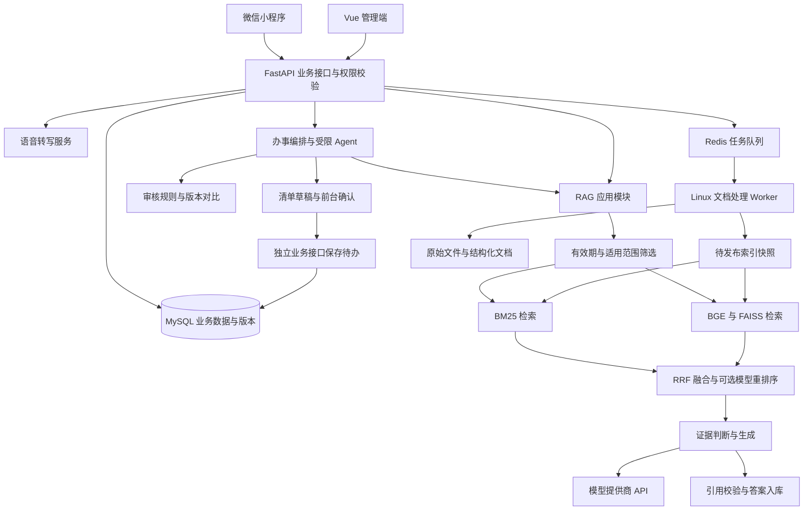

# 校园教务智能问答系统方案

版本：设计建议 v1.1；基础调研日期：2026-09-10；体验与 Agent 修订日期：2026-09-12。新增功能的完整契约见[前台体验与 Agent 方案](./04-前台体验与Agent方案.md)。

## 1 结论与设计边界

2026-09-12 已确认：学校为四川农业大学，权威语料取自教务网及学校其他网站公开文档，由用户后续提供；导师不限定技术方法。现选定路线 A（统一 Python/FastAPI），路线 B 仅留作历史备选，不再作为未决条件。

保留原题目“基于 RAG 技术的校园教务智能问答系统设计与实现”。以教务文档治理、可复现实验和可溯源问答为基础，前台增加语音、办事指南、材料清单、资格自查、版本对比和待办，用完整的办事辅助流程展示成果。

建议形成三项可验证贡献：

1. 面向规章条款和表格的结构化切分与出处保留，减少条件、例外和表头丢失。
2. 中文术语词典、BM25 与 BGE 双路召回、RRF 融合，并通过消融实验决定是否增加模型重排序。
3. 结合年级、专业、政策有效期与证据完整性的回答决策，支持回答、澄清、拒答和冲突提示。

这些属于场景适配和工程实验贡献，不应将 RRF、BGE 或 RAG 本身描述为自创算法。RAG 原始研究和 RRF 原始论文分别见 [Lewis 等](https://arxiv.org/abs/2005.11401)、[Cormack 等](https://research.google/pubs/reciprocal-rank-fusion-outperforms-condorcet-and-individual-rank-learning-methods/)。

### 1.1 规划假设

以单人完成、2026 年 12 月形成稳定系统、2027 年 1—4 月完善论文答辩为基础。初期面向一所学校的公开教务制度，规划 30—100 份有效文件、约 1 千—2 万个切片。规模是预算假设，必须在语料盘点后修订。

第一版不接个人成绩、课表、学籍和选课交易。用户问“我挂了哪门课”应明确说明系统没有个人教务账户数据；不能根据公开政策推断个人状态。奖学金、二课等内容若属于学工或团委管理，需单独标注来源部门，和导师确认是否纳入“教务”范围。

### 1.2 三条实现路线

| 路线 | 组成 | 取舍 | 建议 |
|---|---|---|---|
| A 统一 Python 后端 | 小程序、Vue 管理端、FastAPI、Python RAG 模块 | 服务少，便于调试与实验；需同步修改原报告 Spring Boot 描述 | 默认推荐 |
| B Java 与 Python 双服务 | 小程序、Vue、Spring Boot 业务服务、FastAPI RAG 服务 | 保留原计划，权限与业务归 Java；接口、部署和故障处理工作更多 | 导师要求 Java 时使用 |
| C 基于 RAGFlow 或 Dify 二次开发 | 成熟平台加校园前端 | 首次演示较快，但算法可控性、自主工作说明和消融配置更难 | 已不采用；仅作为参考 |

路线 C 的判断来自项目能力和本课题需求的匹配分析，不是对平台性能的实测结论。用户已确认将 [RAGFlow](https://github.com/infiniflow/ragflow) 作为参考，不作为运行依赖；[Dify](https://github.com/langgenius/dify) 保留为调研对象。不同时引入多个 RAG 编排框架。TinyAgent 位于办事编排层，不替代 RAG 检索模块。

## 2 功能范围和优先级

P0 是可验收的最小系统；P1 是毕设完整版本；P2 仅在论文实验与 P1 完成后开展。

| 优先级 | 学生端 | 管理端与底层 | 验收证据 |
|---|---|---|---|
| P0 | 登录、文字问答、证据卡片、澄清与拒答、历史记录 | 文档上传、解析预览、人工审核、发布下线、双路检索、基础权限 | 真实文件到可追溯答案的完整演示 |
| P1 | 语音转写并确认、多轮追问、适用条件、三个事项指南与清单、有限资格自查、版本对比、待办日期、收藏与反馈状态 | 事项及规则审核、版本回滚、配置版本、基础统计；受限 Agent 适配验证与固定流程回退 | 完整办事演示、消融报告和失败案例闭环 |
| P2 | 答案朗读、拍通知提问、微信订阅推送、联想与热点 | 自动增量采集、更多 OCR 类型、增强重排序 | 确认不影响主线后逐项验收 |

暂不纳入：强化学习训练、多智能体自治、GraphRAG、全校统一身份平台对接、Kubernetes、微服务集群、自动修改教务数据。需要跨多跳关系查询的真实失败证据后，才考虑图检索。

P1 的单 Agent 仅使用已定义的查询和草稿工具，不属于多智能体自治。语音、清单、站内到期提示必须独立于 TinyAgent 可用；对接特定仓库未通过验证时采用固定工作流，不能影响前台交付。

### 2.1 页面设计

学生端底部四个入口为“问答、办事、待办、我的”。问答页有文字/语音、适用条件、多轮对话与证据；办事页有三个已审核事项的表单向导、指南、清单、自查和版本对比；待办页显示清单进度、日期及政策更新复核提示；我的页面提供自填条件、历史、收藏、反馈与数据删除。来源页以抽屉或详情页展示准确原文和版本，能定位时才高亮。

管理员端：文档列表与版本、解析结果预览、待审核队列、检索调试、参数版本、反馈处理、运行统计。第一版统计只需请求数、拒答原因、时延、错误率、令牌消耗和文档更新情况，不优先做复杂“监控大屏”。

证据卡片至少包含文件标题、来源部门、版本日期、适用范围、原文摘录、定位信息。页面明确区分“正在查询”“信息不足”“存在冲突”“生成失败”。加载动画不能伪装成真实生成进度。

## 3 总体架构

图中组件是职责划分，A 路线不代表每个方框都要部署成微服务。开始使用一个 API 进程、一个文档 Worker、MySQL 和 Redis；索引由检索模块在内存读取，文件保存在持久化目录。独立模型推理进程仅在资源竞争明显时增加。

### 3.1 技术选型

| 部分 | 默认建议 | 理由与边界 |
|---|---|---|
| 用户端 | 微信原生小程序 + TypeScript | 保留报告的终端形态；先完成文字和证据展示 |
| 管理端 | Vue 3 + TypeScript + Element Plus | 以表单、表格、审核和调试为主 |
| 后端 | FastAPI + Pydantic + SQLAlchemy/Alembic | 统一 Python 检索与业务接口，维护迁移脚本 |
| 业务库 | MySQL 8 系列的受支持版本 | 会话、用户、文档版本、配置与审计 |
| 嵌入 | BGE-base-zh-v1.5 为基线；低配置测试 small 版本 | 先得到可复现基线，再比较更大模型 |
| 稠密检索 | FAISS CPU，归一化向量 + IndexFlatIP | 小数据集精确检索，无需提前引入 ANN 误差 |
| 稀疏检索 | Jieba 自定义词典 + rank_bm25 | 简单可解释；不要称为工业级倒排搜索引擎 |
| 重排序 | BGE reranker，独立开关 | 用时延与准确性实验决定是否默认开启 |
| 文档解析 | 文本 PDF 提取器 + python-docx；复杂文档试验 Docling | 不把全部格式和扫描件交给同一提取逻辑 |
| 队列 | Redis + Celery，运行在 Linux/WSL2 容器 | 优先承接解析、建索引和批量评测 |
| 模型调用 | 独立 LLMAdapter，模型名和端点配置化 | 记录实际模型标识，不写死报告中的旧型号 |
| 语音 | ASRAdapter + FunASR 中文转写候选 | P1 短音频转文字，可编辑确认；实际配置与速度须实测 |
| 办事编排 | 固定工作流 + 可选 TinyAgentAdapter | 固定流程交付保障，Agent 仅查证据和生成草稿 |
| 部署 | Docker Compose + 反向代理 + HTTPS | 以一台机器可重复部署为目标 |

以上是设计选择，具体依赖版本在首次环境验证时锁定。不要现在凭推测组合“最新版本”。[FastAPI 官方资料](https://fastapi.tiangolo.com/async/)说明异步与并行的区别；远程模型请求主要等待网络，不能因使用 async 就认为本地嵌入计算也不会阻塞。[Celery 官方 FAQ](https://docs.celeryq.dev/en/main/faq.html)明确不支持 Windows，因此 Windows 11 可作为开发主机，Worker 放在 Linux 环境。

### 3.2 必须保留 Spring Boot 时

Spring Boot 唯一负责用户、登录、RBAC、会话、收藏、反馈和对外接口。Python 服务负责解析、嵌入、检索、回答证据与评测。业务数据由 Java 维护；Python 维护知识库和实验数据，避免两端同时修改同一张表。

Java 经内部 HTTP 调用 Python；Python 不直接暴露到公网，内部接口同样认证。Java 传递受控用户上下文和 request_id，Python 不信任客户端自行填写的角色。Celery 任务由 Python 接口创建，避免要求 Java 直接构造 Celery 私有任务消息。发布状态由知识服务作为唯一事实来源，Java 查询或接收幂等通知。

如果选择 B，整个路线中的“业务 API”映射到 Java，RAG 核心和实验保持不变；预留 2—3 周联调弹性，优先削减 P2，不削减实验和引用验证。

## 4 语料治理与文档发布

### 4.1 来源规则

只收录四川农业大学官网、教务部门及学校其他网站的公开权威文档，以及明确授权的校内材料。具体语料由用户后续提供，目前没有下载其他学校制度充当本校事实。学生群聊天、个人笔记和模型生成的政策不能作为权威依据。

每份文件记录：原始 URL、来源部门、获取日期、发布日期、生效与失效日期、适用年级/学院/专业/培养层次、文件编号、替代关系、内容哈希和审核状态。发布日期不等于生效日期；较新文件不必然覆盖所有旧文件。

同一文件同一哈希重复上传应复用结果。不同版本建立明确替代关系。新版本不直接覆盖历史文件，保留历史问答当时引用的版本。

### 4.2 处理管线

上传校验 → 文件类型识别 → 文本/版面提取 → 扫描页 OCR 分支 → 标题与条款识别 → 表格规范化 → 清洗去重 → 元数据补全 → 管理员预览 → 切分与嵌入 → 构建双路索引 → 验证 → 发布。

Docling 提供多格式解析、表格结构、OCR 和结构化导出，可作为复杂样本的候选解析器；实际质量需用本校样本评估，不能从 README 推导“全部正确”。[项目说明](https://github.com/docling-project/docling)

原始文件、结构化 JSON、用于阅读的 Markdown 分别保存。不能只保存 Markdown，因为页坐标、表格单元格和条款层级往往需要结构化字段。PDF 同时记录物理页序号和可识别的印刷页码；DOCX 默认以标题、条款和段落定位，不虚构稳定页码。

流程图第一版采用人工核对的步骤说明并关联原图。若未开发视觉理解模型，论文写“文本、表格和扫描文档解析”，不笼统宣称实现完整多模态理解。

### 4.3 切分策略

基线为固定 token 窗口，初值 320 tokens、重叠 48 tokens；增强方案按“文件—章节—条款—子条款”分层，子块用于检索，适量父级文本用于生成。所有长度按嵌入模型 tokenizer 计算，标题前缀与正文合计不得超过模型限制；不能把 512 汉字直接当作 512 tokens。模型参数参照 [BGE 模型卡](https://huggingface.co/BAAI/bge-base-zh-v1.5)。

每个子块保留标题路径；条件和例外尽量留在同一块。表格按表头与记录切分，每条记录重复必要表头并保留单位、脚注和适用年份。超长条款继续细分，并建立 parent_id。不得为了让模型“读得顺”而改写原始数值。

每个 chunk 保存稳定的证据定位信息。不同切分策略会改变 chunk_id，实验金标准使用文档版本 + 原文跨度/条款 ID，再映射到各策略切片，避免基线因 ID 不一致被错误扣分。

### 4.4 发布一致性

文档状态：uploaded → parsing → review_pending → approved → indexing → ready；失败进入 failed，重试保留错误原因。索引状态：building → validated → active → retired。

每个索引版本包含 BM25、FAISS、chunk 映射、嵌入模型标识、分词词典版本和语料清单。校验切片数量、ID 映射、向量维度、内容哈希和冒烟查询后，原子切换 active_index_version。一次请求固定一个版本，双路检索禁止混用新旧切片。

发布采用后台构建新快照，前台继续读取旧快照；切换失败保留原版本。并发发布采用单写锁与幂等键。管理员撤回文档时立即增加拒绝访问标记，阻止检索、原文下载和旧缓存输出，再异步重建索引。历史记录可显示“该来源已撤回”，不可继续展示已被禁止公开的内容。

## 5 在线 RAG 流程

### 5.1 请求处理

1. 校验身份、会话所有权、输入长度和频率，生成 request_id。
2. 从当前问题和经过确认的会话条件提取学年、入学年级、学院、专业、事项与查询日期。
3. 必要条件缺失且可能影响结论时先追问；若不影响检索，先检索再决定是否澄清。
4. 仅对存在指代或省略的问题尝试查询改写，保留原问题并行召回。不得扩写出用户未提供的年级、分数、专业或课程编号。
5. 先校验可见性、发布状态和适用条件，再执行 BM25 与向量检索。
6. 每路初始取 20 个候选，按 chunk_id 合并、RRF 融合；按需重排前 20 个，选择约 4—6 块证据。参数是起点，不是已证实最优值。
7. 检查证据是否覆盖关键条件、是否存在版本冲突，选择回答/澄清/拒答/冲突提示。
8. 构造证据受限提示词，生成带引用 ID 的结构化答案。
9. 校验引用 ID 和来源权限，保存完整结果、版本和运行耗时，再返回用户。

### 5.2 混合检索细节

BM25 词典包括“高数 A1”“缓考”“重修”“第二课堂”等真实术语；同义词关系必须人工维护。保留数字、课程代码和否定词，避免粗暴停用词处理。[rank_bm25](https://github.com/dorianbrown/rank_bm25)本身不负责文本预处理，文档和查询必须采用相同分词规则。

RRF 初值：score(d) = Σ 1 / (60 + rank_i(d))，排名从 1 开始，未出现在该路结果中的贡献为 0。先使用等权；如果研究加权变体，单独记录权重并在开发集选择，不能把原始相似度、BM25 分数和 RRF 分数直接混加。[RRF 论文](https://cormack.uwaterloo.ca/cormacksigir09-rrf.pdf)

RRF 是排序融合。Cross-encoder reranker 则将问题和文本一起评分，是后续不同阶段；其分数即使映射到 0—1，也不是答案正确概率。[BGE reranker 官方示例](https://github.com/FlagOpen/FlagEmbedding/blob/master/examples/inference/reranker/README.md)

### 5.3 FAISS 与过滤的实际实现

FAISS 是向量检索库，业务元数据和权限由应用管理。官方 FAQ 说明其检索时过滤能力有限且基于向量 ID；不能写成“FAISS 原生支持任意标签查询”。[官方 FAQ](https://github.com/facebookresearch/faiss/wiki/FAQ)

本项目小规模默认：先从元数据生成 eligible_ids，再在对应向量子集上精确评分；可缓存常用范围的子索引。无额外范围约束时使用全量已发布公开索引。BM25 使用同一 eligible_ids 屏蔽不合格项后取 Top-K。授权约束永远不因结果不足而放宽。

主题、意图等模型推断标签只作为软排序信息，不能硬过滤导致漏检；有明确适用范围但用户尚未提供时保留候选并追问。若采用过量召回再过滤，需要明确它可能漏掉合格证据，并与前置精确过滤比较。数据量增长后再评估支持业务过滤的向量服务，当前不同时建设多套存储。

### 5.4 政策时间与冲突

“2023 级”存为 cohort，“2026—2027 学年”存为 academic_year，不混用。每轮请求确定 as_of_date；用户询问历史制度时按历史日期处理。生效期或适用范围未知的文档不能自动判为全校现行规则。

只在适用对象和事项相同、且存在明确替代关系时以新版本覆盖旧版本。若两份权威文件互相矛盾但缺少替代依据，展示冲突出处并提示向来源部门核实。来源部门联系方式必须来自文件或审核配置，禁止生成电话号码。

### 5.5 回答和引用契约

答案类型：answered、clarification、insufficient_evidence、policy_conflict、out_of_scope。生成技术错误单独使用 error，不计入政策拒答。

输出包含 summary、conditions、steps、citations、missing_fields 和 status。每个可核查政策结论关联一个或多个 citation_id。引用内容由后端根据检索结果组装，模型只选择合法 ID；原文链接和页码不能由模型自由生成。

ID 有效只证明来源存在，不证明结论被支持。数字、截止日期、对象等关键字段增加规则比对，语义支持用人工评测和可选自动判别评估。证据相似度高但缺少关键条件时仍应追问或拒答；阈值通过开发集校准。

P0 先返回验证后的完整答案。P1 可显示“正在整理依据”等阶段事件，待引用校验后发送最终答案。若增加正文 token 流，必须标注为未完成内容，并允许最终结果替换，避免未经校验的错误结论被当作正式答复。

### 5.6 多轮记忆

只传入最近有限轮对话和用户明确确认的条件，不无限拼接历史。模型旧回答不作为政策证据，新问题仍需重新检索。用户改变专业或年级后更新当前会话状态；清空会话应清掉相应上下文。不要把用户 A 的会话摘要带入用户 B。

### 5.7 缓存和容错

第一版优先缓存嵌入、解析产物和精确检索结果，不做跨用户语义答案缓存。检索缓存键包含规范化查询、权限范围、适用条件、as_of_date、索引版本与检索配置版本。

模型超时或断网时返回可验证证据摘录并明确“回答生成失败”，不把摘录冒充完整答案。调用设置总超时和有限重试；已输出内容后的重试需避免重复回答和重复计费。限流采用 429，暂时不可用采用 503，并给出可重试提示。

## 6 数据模型

以下是核心建表依据，实际字段类型和索引在数据库迁移中固定。主键统一采用 UUID 或统一的整数方案，不能各模块随意混用。v1.1 新增偏好、事项规则、Agent 运行、清单草稿、待办日期和更新通知实体，见[前台方案第 5 节](./04-前台体验与Agent方案.md)。

| 表 | 关键字段 | 约束与用途 |
|---|---|---|
| users | id, external_subject, role, status | 外部身份唯一；角色只由服务端授予 |
| documents | id, title, source_url, issuer, visibility | 逻辑文件；URL 不是本地任意路径 |
| document_versions | id, document_id, hash, dates, scope, supersedes_id, review_status | 一个文件多版本；原始内容不可原位修改 |
| chunks | id, version_id, parent_id, section_path, locator, text, token_count | 关联原文位置，不直接保存裸向量作为业务真值 |
| index_versions | id, manifest_path, model_revision, tokenizer_revision, state | manifest 对应完整双路快照 |
| ingestion_jobs | id, version_id, status, attempts, error_code | 任务幂等、可重试和可追踪 |
| conversations | id, user_id, confirmed_scope | 所有访问按 user_id 授权 |
| messages | id, conversation_id, role, body, answer_status, request_id | request_id 唯一或关联唯一生成记录 |
| answer_citations | id, message_id, chunk_id, source_snapshot | 留存历史出处；撤回访问策略覆盖展示 |
| favorites | user_id, message_id, created_at | 联合唯一；校验消息所有权 |
| feedback | id, user_id, message_id, category, comment, state | 原因分类、处理人与处理结果 |
| rag_configs | id, config_json, created_by, activated_at | 参数版本化；在途请求不切配置 |
| query_runs | id, request_id, index_id, config_id, provider_model, timings, usage, error | 实验和故障复盘 |
| audit_logs | id, actor_id, action, object_id, before_after, timestamp | 文档发布、撤回、配置和权限变更 |

文档适用范围可在 v1 用经过校验的 JSON 表达，复杂筛选再规范化为关联表。为 conversation_id/time、document_id/version、job/status 和 query_runs/time 建索引。原始文件按生成的安全 ID 存储，禁止用上传文件名直接拼接访问路径。

## 7 接口与模块契约

统一前缀 `/api/v1`。响应携带 request_id；错误结构为 code、message、retryable、request_id。列表分页，时间采用带时区 ISO 8601，显示按北京时间。语音、事项、自查、对比、Agent 和待办的扩展接口见[前台方案第 5 节](./04-前台体验与Agent方案.md)，与下表共同构成 v1.1 接口范围。

| 接口 | 用途 | 权限和关键行为 |
|---|---|---|
| POST /auth/wechat | 登录换取应用会话 | 服务端验证登录凭据；开发身份仅在开发环境启用 |
| POST /conversations | 创建会话 | 学生；绑定服务端用户 |
| POST /conversations/{id}/messages | 提问并返回完整答复 | 所有权、限流、客户端幂等键 |
| GET /conversations/{id}/messages | 历史记录 | 仅本人；撤回来源按策略隐藏 |
| DELETE /conversations/{id} | 删除会话 | 本人；明确关联数据清理策略 |
| POST /messages/{id}/feedback | 提交反馈 | 本人；长度限制 |
| PUT /favorites/{message_id} | 收藏 | 本人；重复提交不重复创建 |
| GET /sources/{citation_id} | 获取证据和授权原文入口 | 每次检查来源与会话权限 |
| POST /admin/documents | 上传并启动解析 | 管理员；返回 202 和 job_id |
| GET /admin/jobs/{id} | 查询处理状态 | 管理员；不暴露服务器内部路径 |
| POST /admin/versions/{id}/approve | 审核通过 | 记录审核人和元数据完整性 |
| POST /admin/indexes/build | 构建快照 | 管理员；异步且幂等 |
| POST /admin/indexes/{id}/activate | 发布或回滚 | 校验通过后原子切换 |
| POST /admin/versions/{id}/withdraw | 下线来源 | 即时访问屏蔽，随后重建 |
| POST /admin/retrieval/debug | 查询召回证据与评分 | 管理员；不能泄露给学生 |
| POST /admin/configs | 保存配置版本 | 参数范围验证，不执行用户代码 |
| GET /admin/metrics | 查看聚合运行信息 | 管理员；默认不展示原始个人问题 |

RAG 模块接口建议：parse(file) → blocks；chunk(blocks, config) → chunks；retrieve(query, scope, version) → candidates；fuse(candidates) → ranked；decide(evidence, context) → answer_mode；generate(evidence) → answer；validate(answer, evidence) → final_result。通过依赖注入替换模型服务，离线测试不用消耗真实 API。

小程序网络、登录与录音需在实际开发工具及 Android/iOS 真机验证。微信官方相关文档未成功读取，当前不承诺其具体版本兼容性；P0 用完整响应，P1 Agent 运行状态默认轮询。额外流式正文为资源允许时的增强，不能直接照搬浏览器 EventSource。

## 8 并发和运行可靠性

在线问答采用异步网络调用 + 有界并发；长时解析、嵌入批处理、实验放后台队列。资源紧张时，后台任务降低优先级，避免抢占在线嵌入资源。

如果后续实测必须将问答排队，增加 202/job_id 协议以及 queued/running/succeeded/failed/cancelled 状态、最大等待时间和取消行为。不要第一版就让所有聊天进入无限队列。

粗略容量估算：并发模型槽位为 C、平均服务时间为 T 秒，则理想服务能力约 C/T 请求每秒，仍受提供商限额、令牌速率和本地嵌入影响。队列只能缓冲突发，无法使长期超过服务能力的流量稳定运行。

必须有并发上限、输入与输出 token 上限、队列长度上限、超时、健康检查、磁盘容量检查和日志轮转。发布前演练 API 不可达、Worker 中断、索引构建失败、数据库重启及快照回滚。

## 9 安全与数据管理

小程序不存模型密钥；管理员角色由后端数据库判定，前端隐藏按钮不能代替授权。对会话、任务、文件、引用和调试接口分别做对象级权限校验。JWT 校验签名、有效期和应用身份约束，并设计注销/失效策略。

只接受允许的文件类型，验证真实格式，限制大小与页数，解析超时隔离。上传材料和检索片段是数据，不能执行其中的“忽略规则、泄露提示词”等指令；第一版生成模块没有执行系统命令或任意 URL 请求的权限。

公开政策可进入云模型上下文，个人敏感材料默认不收录。日志去除令牌、密钥和不必要的个人标识；演示使用测试账户。建议详细运行日志保留 30 天、会话由用户删除或按项目约定清理，正式上线前由学校确认保留规则。

备份至少覆盖数据库、原始文件、索引 manifest 和运行配置；模型权重可重新下载但应保留版本标识。备份必须做一次恢复验证，不能只检查压缩包是否存在。

## 10 成功条件与优先优化项

完整验收必须同时具备：真实语料和金标准题集、可运行程序、原文引用、异常处理、对照实验、部署说明与答辩演示。详细指标见开发路线文档，所有数值均为拟定目标，当前没有实测结果。

按收益排序的优化顺序：修复错误解析 → 补齐适用元数据 → 校验条款切分 → 建好中文术语词典 → 混合召回 → 引用与拒答 → 重排序 → 查询改写 → UI 扩展。若数据本身不可信，更换大模型不能弥补。

每个增强项都必须回答三个问题：解决哪类已观察错误，增加多少时延或维护成本，是否在独立测试集上有效。没有证据的增强项保留为可关闭实验，不强行写入最终系统默认链路。
