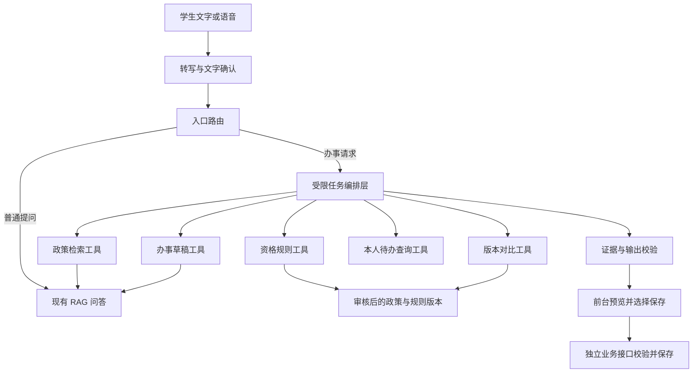

# 前台体验与 Agent 集成方案

版本：v1.1；更新日期：2026-09-12。本文补充并落实主方案中的学生端产品设计，功能优先级已同步到系统方案和开发路线。当前仅完成设计与资料核查，未部署 TinyAgent 或语音模型。

## 1 本轮决定

系统定位从“带出处的政策问答”扩展为“可溯源问答与办事辅助”。题目仍保留 RAG 主线，Agent 是将查询结果转成办事草稿的应用层，论文核心实验仍是检索、结构和适用范围。

确定将 RAGFlow 作为文档管理与引用交互的参考，不作为运行依赖。必做前台增加语音输入、办事指南与材料清单、有限事项资格自查、政策版本对比、待办与截止日期中心。已有多轮追问、证据卡片和收藏升级为可操作页面。

Agent 功能纳入 P1，但不把特定 TinyAgent 仓库绑定为交付前提：先用相同工具接口完成固定工作流，再试验轻量 Agent 适配；适配失败时完整的办事功能仍可使用。

## 2 TinyAgent 的含义和接入判断

### 2.1 两个同名项目

| 对象 | 已核查能力与限制 | 与本项目关系 |
|---|---|---|
| [SqueezeAILab/TinyAgent](https://github.com/SqueezeAILab/TinyAgent) | EMNLP 2024 演示项目，研究小模型函数调用；示例偏 macOS；README 说明开源模型与 ToolRAG 在原工具集上微调 | 参考函数调用与任务分解思路，不直接移植桌面应用或假定预训练模型理解校园工具 |
| [mozilla-ai/tinyagent](https://github.com/mozilla-ai/tinyagent) | Python Agent 循环，支持工具、回调、取消、执行追踪及 MCP | 未指定仓库时的默认适配候选；需验证实际模型兼容性与调用限制 |

两者不是同一项目。Mozilla 版本不是论文版的必然升级版，其能力也不能反向归因于论文版。论文背景参见 [TinyAgent: Function Calling at the Edge](https://arxiv.org/abs/2409.00608)。

本轮尚未收到具体仓库地址，默认按上表分别处理；若用户之后提供其他 TinyAgent，按相同接口检查可替换性。默认采用现有云端生成模型评估工具调用，不增加小模型微调、端侧部署或全离线承诺。

### 2.2 三种结合方式

| 方式 | 优点 | 成本 | 决策 |
|---|---|---|---|
| 固定办事工作流 | 稳定、易测，按钮和表单都能操作 | 自由组合任务能力有限 | P1 必须具备的基线与回退 |
| RAG + 受限 TinyAgent 适配层 | 可从一句话组合检索、清单、自查、对比 | 增加模型调用、超时与工具参数校验 | 推荐进行限时接入验证 |
| 移植端侧模型与完整工具平台 | 可研究小模型与工具检索 | 训练数据、兼容性和部署工作显著增加 | 本科毕设主线不采用 |

本项目的文档 RAG 检索政策证据；论文 TinyAgent 的 ToolRAG 检索工具描述与示例，两者检索对象不同。初期只有 5 个业务工具，直接提供白名单即可，不为使用 ToolRAG 而扩大工具库。

## 3 学生能直接使用的功能

### 3.1 核心功能清单

| 功能 | 用户操作与可见结果 | 实现边界 | 优先级 |
|---|---|---|---|
| 语音提问 | 按住录音，看到识别文字，修正后发送 | 先做短音频转写，不做持续通话 | P1 必做 |
| 场景式办事向导 | 点“缓考/重修/成绩复核”，按卡片补全条件 | 首批只选本校资料齐全的 3 个事项 | P1 必做 |
| 材料与步骤清单 | 将答复转为清单，可勾选、编辑个人备注并保存 | 政策条目带引用，个人新增事项单独标注 | P1 必做 |
| 资格自查 | 填年级和事项条件，逐项显示符合、不符合或待核实 | 仅做 1—2 个规则明确事项，不代替学校审核 | P1 必做 |
| 政策版本对比 | 选择同一事项的两版政策，查看条件、材料、时限差异 | 只比较管理员关联的政策家族，证据不足不强行结论 | P1 必做 |
| 我的待办 | 查看清单进度、截止日期和到期排序，修改或删除 | 站内到期提示必做；系统外推送为扩展 | P1 必做 |
| 个性化适用条件 | 显示“按 2023 级/某专业查询”，点击可改 | 用户自填，不冒充教务验证身份 | P1 必做 |
| 可交互引用 | 点击每项结论查看原文及版本，再返回原位置 | 有坐标才定位高亮，无坐标显示准确摘录 | P0/P1 |
| 智能追问 | 点击缺失字段选项补全年级、学年等条件 | 不反复询问已有信息，不猜用户条件 | P0/P1 |
| 纠错与处理反馈 | 选择“政策过期/答非所问”等原因，查看处理状态 | 区分已收到、已处理；不直接污染知识库 | P1 |
| 答案朗读 | 点击播放已验证答案，暂停或停止 | 独立 TTS 适配，关闭默认自动播放 | P2 |
| 拍通知提问 | 图片 OCR 后可编辑文字，查官方对应政策 | 用户截图不是自动可信来源，不直接入公共库 | P2 |

语音、清单、对比等不是额外堆几个按钮：每项均有持久化、异常状态和验收。取消原计划对热搜大屏、无限泛化 Agent、复杂语义改写的优先投入，为学生功能留出时间。

### 3.2 语音交互细节

采用“点击/按住录音 → 松开发送到转写服务 → 展示可编辑文本 → 用户点击提问”流程。用户可以取消录音、重录、切换键盘；识别后不自动创建待办。麦克风拒绝授权时直接保留文字入口。

初值为最长 30 秒、上传上限 5 MB，服务端检查实际格式、时长和解码结果，统一为模型所需采样率与声道。对空白、过短、噪声、上传失败和识别超时分别提示，不把失败显示成空答案。数字、课程代码和否定词是重点测试对象。

默认试验 FunASR 的 Paraformer 中文转写路径及领域热词；精确模型、版本、CPU 推理速度在实施验证时锁定。FunASR 是工具集，不同模型对实时转写、热词和时间戳支持不一致，不能将一种配置的能力套用到全部配置。[官方仓库](https://github.com/modelscope/FunASR)

语音服务隔离并限制并发，避免占满 RAG 嵌入资源。ASRAdapter 提供替换入口；本地无法达到体验目标时，可切换经过确认的云端 ASR。服务端临时音频处理后删除，异常遗留文件最长 24 小时清理；默认不留声纹，不收集情绪数据。保存文本前遵循普通会话规则。

### 3.3 办事指南和材料清单

指南固定包含：适用对象、办理条件、材料、步骤、受理部门、办理方式、截止规则与引用。找不到的字段明确写“现有材料未说明”，不生成窗口地址或联系电话。

清单首先是草稿，学生检查后点击“保存到我的待办”。每项保存政策来源与版本，勾选仅表示用户自报已准备，不表示学校已受理。用户可以添加个人备注和自定义任务，但不得改写后仍标成政策原文。

更新政策时，已有清单标记“依据有更新，请复核”，不能静默覆盖用户勾选状态。重新生成展示差异，用户选择后创建新修订版；已撤回证据按主方案隐藏，清单提示依据已撤回并阻止作为现行办理建议继续推荐。

### 3.4 资格自查

首批选择 1—2 个政策规则明确且有充分材料的事项；其余事项提供指南而不宣称能计算资格。规则由管理员从原文整理并复核，版本绑定政策。模型仅辅助提取用户输入与解释，最终条件匹配由确定性规则执行。

输入字段只收必要条件，学生可随时修改。输出逐条列“满足/不满足/尚不确定”、用户输入、依据和缺失材料。出现模糊酌定条款、冲突或必要信息未知时，总结不得输出“可以申请成功”。页面注明结果基于自填信息，是自查结果。

不使用 LLM 临时生成的表达式或代码执行资格计算；只有显式列举的等值、区间和逻辑组合操作。针对例外、边界值及“且/或”关系做专门测试。

### 3.5 政策对比

从一个已登记事项选择旧版和新版，按适用对象、申请条件、材料、办理流程、时限比较。每个差异行附两侧证据。找不到对应条款时标“未找到对应说明”，不等同于“已取消”。没有变化的字段可以折叠。

先支持确定版本的单事项对比，不做任意两个长文件的全量法律式修订分析。日期变化与适用人群变化分开显示，新发布日期不代表用户应采用新版。

### 3.6 待办、截止日期和更新提示

默认提供列表加日期排序、进度和到期标识，暂不做复杂日历组件。截止日期区分“政策明确日期”“依据事件计算”“用户自定目标”；后者不能被显示成官方截止日。遇到“考前 N 个工作日”等规则，若缺少考试日期或校历，要求补充，不能按自然日猜算。

站内提醒表示学生打开小程序时看到到期或更新信息，并不意味着关闭应用后仍推送。微信订阅消息受平台接入和授权条件影响，P2 验证成功后才承诺；无推送能力时界面不显示“将通知你”。本轮微信官方页面未成功读取，兼容条件由实施阶段真机与官方最新说明验证。

### 3.7 页面组织

底部四个入口：**问答、办事、待办、我的**。

- 问答：文字/语音入口、当前适用条件、历史对话、结论卡和证据抽屉。
- 办事：三个首批事项、引导表单、材料清单、自查与版本对比入口。
- 待办：未完成、已完成和需复核事项，按日期排序，支持清单详情与备注。
- 我的：自填学习信息、收藏、反馈记录、会话与数据清理。

普通学生界面不显示 BM25、Top-K、工具调用 JSON、模型推理过程等术语。“查找规定”“核对适用条件”“整理材料”只由真实后端阶段事件驱动，不展示伪造进度条。管理员调试页面再显示召回和工具记录。

## 4 Agent 如何接在 RAG 上

无论 TinyAgent 是否启用，用户看到同一组业务功能。固定工作流由按钮确定事项和步骤；Agent 模式允许一句话组合只读查询与草稿生成。两种方式调用同一工具、使用同一证据规则，便于比较。

### 4.1 工具白名单

| 工具 | 主要参数 | 输出 | 边界 |
|---|---|---|---|
| search_policy | question, confirmed_scope, as_of_date | 已授权证据与版本 | 沿用 RAG 检索和引用规则 |
| build_checklist_draft | procedure_id, confirmed_fields | 指南与清单草稿 | 内部查证据，模型不能直接传入自编政策 |
| check_eligibility | procedure_id, answers | 逐条规则结果 | 只执行已审核规则 |
| compare_policy_versions | policy_family_id, version_a, version_b | 双侧证据与结构化差异 | 校验版本关系、权限和适用范围 |
| list_my_tasks | status, date_range | 本人待办摘要 | user_id 从会话注入，不由模型指定 |

保存、修改、删除待办由普通业务接口处理，执行型接口不暴露给 Agent。Agent 只能输出草稿，前台点击保存后才发起业务提交。这使预览与实际操作有明确边界，不依赖提示词禁止误操作。

### 4.2 执行约束与错误回退

AgentAdapter 是可替换接口，TinyAgent 运行在服务端。主方案的 LLMAdapter 和框架模型适配之间需要显式映射；验证所选提供商的工具调用、参数格式、异步和取消能力，不能凭通用兼容接口就认为全部支持。

初值：最多 4 轮工具调用、总计 6 次工具执行、总时限 30 秒；外层编排限制必须覆盖子工具内部模型请求和累计 token，不能只计框架回调次数。相同参数的重复调用可复用结果；出现无进展循环立即退出。

每次运行固定用户、政策快照和配置版本。返回结构不符合约定时最多一次修复，仍失败回到办事表单；部分工具成功时显示已完成结果和未完成部分，不虚报全部完成。缺条件进入 awaiting_input，用户补充后开启受控续跑；不把服务器请求一直挂起等待用户。

保存草稿前检查所有权、过期状态和政策是否仍有效。确认凭证绑定 user_id、draft_id、草稿内容哈希和有效期；修改内容即失效，重复提交用幂等键返回同一待办。若生成后政策变更，返回“依据已更新，请重新核对”，不保存过时建议。

用户材料、语音文字和检索证据都不能改变工具白名单。第一版不开放任意网页抓取、Shell、数据库查询、发邮件或登录教务系统能力。追踪只保存必要状态与脱敏参数，不显示或要求保存模型隐藏推理。

### 4.3 接入验证门槛

先用固定工作流跑通，再给 TinyAgent 适配最多 2—3 个工作日的技术验证预算：完成查询和清单草稿、参数校验、超限取消、超时、跨用户隔离，以及与指定模型连接测试。此预算是停损点，不是整个 Agent 产品的开发工期。

验证通过再纳入 P1；未通过则保留相同前台和固定工作流，把 TinyAgent 作为研究参考。论文必须准确写实际集成了哪个仓库、哪些代码或只借鉴了哪些思路，不能将接口预留写成已接入。

## 5 新增数据与接口

### 5.1 数据实体

| 实体 | 关键内容 | 一致性要求 |
|---|---|---|
| student_preferences | 自填年级、专业、培养层次 | 可删除；每轮明确当前适用条件 |
| procedures / procedure_versions | 事项模板、字段与政策引用 | 发布状态与政策版本绑定 |
| eligibility_rule_sets | 审核规则、适用范围、规则版本 | 原文撤回即停止提供肯定结论 |
| agent_runs / tool_runs | 状态、工具、参数摘要、用量、错误 | 关联 request_id、用户和快照 |
| action_drafts | 结构化草稿、内容哈希、证据、过期时间 | 草稿不是已保存待办 |
| task_lists / task_items | 条目、勾选状态、个人备注、来源版本 | 所有权、修订号与幂等提交 |
| task_dates | 日期、时区、日期来源、计算依据 | 用户日期与官方截止日分开 |
| update_notices | 用户、关联待办、变更版本、已读状态 | 仅展示当前有权查看的来源 |

以上由原有业务库扩展，不另建 Agent 数据库。Java/Python 双服务路线中，待办与偏好由 Java 负责，Python 返回草稿，不越过 Java 直接写个人业务表。

### 5.2 接口草案

| 接口 | 作用 | 关键规则 |
|---|---|---|
| POST /api/v1/speech/transcriptions | 音频转文字 | 限流、格式校验、临时文件清理；返回可编辑文字 |
| GET/PATCH /api/v1/me/preferences | 查看和修改自填条件 | 不接受角色或外部认证状态 |
| GET /api/v1/procedures | 可办理事项目录 | 仅已发布且可见的事项 |
| POST /api/v1/procedures/{id}/drafts | 固定工作流生成草稿 | 返回引用与缺失条件 |
| POST /api/v1/procedures/{id}/self-check | 资格自查 | 规则版本和逐项结论 |
| POST /api/v1/policy-comparisons | 对比已关联版本 | 输出结构化差异和双侧引用 |
| POST /api/v1/assistant/runs | 自然语言办事请求 | 幂等创建，返回 202 和 run_id |
| GET /api/v1/assistant/runs/{id} | 读取真实状态及结果 | 本人；P1 默认轮询，后续可加事件流 |
| POST /api/v1/assistant/runs/{id}/input | 补充条件 | 检查 awaiting_input 与修订号 |
| POST /api/v1/assistant/runs/{id}/cancel | 取消运行 | 取消信号传递至工具；不影响已保存待办 |
| POST /api/v1/task-lists | 保存已确认草稿 | 验证 draft_id、哈希、所有权、幂等键 |
| GET /api/v1/task-lists | 待办与日期排序 | 本人；分页 |
| PATCH /api/v1/task-items/{id} | 勾选、备注或自定日期 | 乐观锁；不伪装为修改政策来源 |
| DELETE /api/v1/task-lists/{id} | 删除待办 | 本人；关联提示同步清理 |
| GET /api/v1/me/update-notices | 更新与到期提示 | 站内读取，不承诺微信推送 |

管理员扩展事项/规则的草稿、预览、审核、发布和撤回接口，复用现有审计记录与发布流程。资格规则上线必须有可追溯审核人；一个学生项目中可以由同一管理员审核，但不能宣称已实现双人审核制度。

## 6 新功能的验收和实验

### 6.1 必须跑通的验收

1. 语音中的“不能”“2023 级”“高数 A1”识别后可修正，未点击发送不进入问答。
2. 缓考等实际事项能产生带依据的材料清单，保存后重新打开仍有勾选进度。
3. 同一自查题缺字段时不判定符合，边界值按审核规则计算。
4. 政策对比中每个已判定变化有双侧证据，缺条款显示未知。
5. 自定日期与政策截止日期视觉区分，模糊工作日规则不自动猜算。
6. Agent 误选工具、超时或不可用时，用户能转到表单完成同样事项。
7. 修改后的草稿不能复用旧确认凭证，重复保存不生成两份清单。
8. 政策发布更新后旧清单出现复核提示，撤回后受限内容不再显示。
9. 用户 A 不能通过 run_id、draft_id、task_id 或 citation_id 读取用户 B 的数据。

### 6.2 增加轻量体验评价

保留原 E0—E7 检索实验，不在其中混入 ASR 误差。另设 30 个办事任务实例，比较同一模型与同一工具下的固定工作流和 Agent 编排：任务完成率、工具及参数正确率、耗时、调用成本、回退率。必须先定义每题完成条件，不能只让模型评价自己。

语音评价收集经同意的 30—50 段短录音，覆盖安静/有背景声、数字/简称/否定词。报告 CER、关键字段准确率、转写延迟与用户修正次数。用同一问题的人工正确文本作为对照，区分语音错误和 RAG 错误。原始音频仅按明确的测试留存约定保存，不混入生产默认清理策略。

邀请约 5—8 名同学完成文字查询、语音查询、保存清单、查看差异等任务，记录完成率、耗时、误操作和简短反馈。小样本只作可用性观察，不能宣称代表全校用户。功能验收目标是在预设范围内可用，不预先声称 Agent 比固定流程更优秀。

## 7 答辩演示主线

建议约 7 分钟，所有具体材料、日期与规则用本校已审核内容替换：

| 时间 | 操作 | 可展示能力 |
|---|---|---|
| 0:00—1:00 | 语音提出办理某事项的需求，确认识别文字 | 语音输入与可纠错交互 |
| 1:00—2:00 | 系统追问年级/必要条件，显示适用标签 | 多轮澄清与个性化范围 |
| 2:00—3:00 | 查看指南、材料和原文证据 | RAG、结构化答复与引用 |
| 3:00—4:00 | 运行一个规则明确事项的自查 | 可解释规则判断与缺信息处理 |
| 4:00—5:00 | 保存清单、勾选准备项、设置个人目标日期 | 办事辅助、持久化与日期管理 |
| 5:00—6:00 | 查看关联新旧政策差异及清单复核提示 | 版本管理的用户价值 |
| 6:00—7:00 | 展示无依据处理、简短实验结果 | 系统边界与方法效果 |

演示政策更新可使用预置测试版本，但必须标为演示数据。若 Agent 未通过接入门槛，演示固定向导并如实说明；若接入成功，再展示一句话组合查询与清单草稿的工具执行结果。

## 8 工作量控制

新增工作粗估 55—85 小时，包括语音、事项模板/清单、规则自查、对比、待办、Agent 适配及测试。与原 P1 的引导、收藏和适用条件有重叠，应合并实施，不重复造页面。总开发预算由原 190—290 小时调整为约 245—375 小时，16 周平均约 15—24 小时。

若实际时间不足，按顺序削减：朗读/拍照/微信推送 → 复杂热搜与大屏 → 额外 reranker/改写组合 → Agent 自由编排；保留语音、三个事项清单、至少一个自查、一个政策家族对比及核心实验。固定工作流承担 Agent 回退，确保功能不随框架试验失败而消失。

## 9 本轮资料与核验范围

访问日期：2026-09-12。

- [SqueezeAILab/TinyAgent](https://github.com/SqueezeAILab/TinyAgent)：核查示例应用、ToolRAG 与自定义工具限制。
- [TinyAgent 论文](https://arxiv.org/abs/2409.00608)：端侧函数调用研究背景，不将其结果外推为本校任务性能。
- [mozilla-ai/tinyagent](https://github.com/mozilla-ai/tinyagent)：核查工具循环、追踪、回调及取消能力，未做本地兼容测试。
- [FunASR](https://github.com/modelscope/FunASR)：核查语音工具集、模型差异与热词示例，具体配置必须实测。
- 微信录音与订阅消息官方页面本轮抓取失败，因此平台接入与真机兼容性保留为实施门槛，不承诺现成推送或实时语音通话能力。

本文中业务规则、页面布局、时间预算和验收用例为本项目设计，不是第三方框架自带功能。
