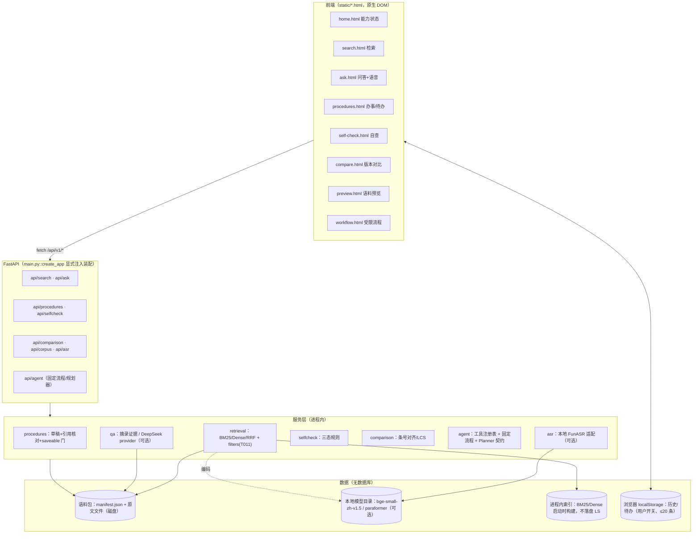
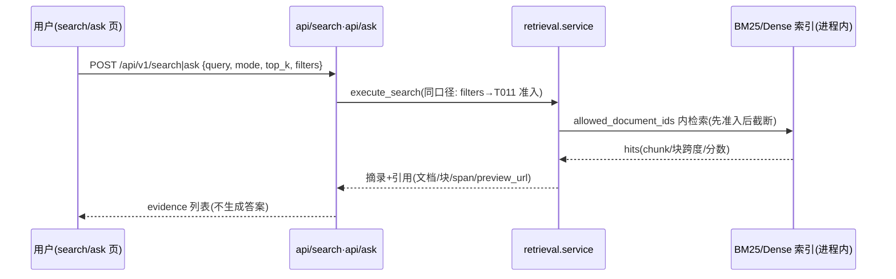
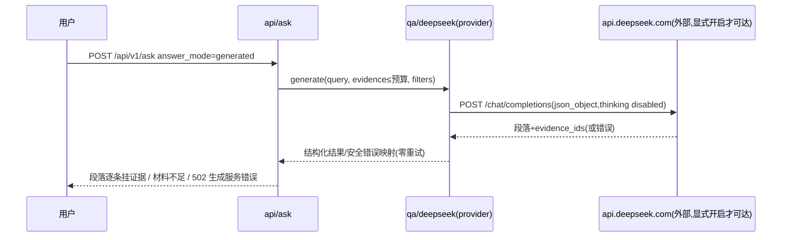
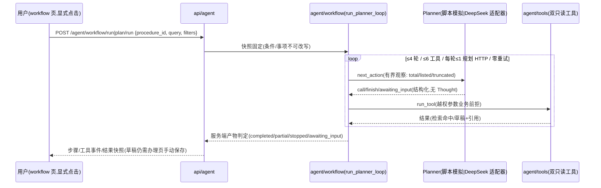

# 系统设计（system-design.md）

> T028 交付包｜依据**当前实际代码**（step2_code/backend，截至 T027 revision 3）整理。旧方案 docs/01—04 为规划文档，本文件以实现为准；差异处以本文件为准。不虚构数据库、登录账户或部署架构。

## 1. 需求与用户流程

**目标**：面向学生的校园教务助手（本地 Windows 运行）：政策原文检索与摘录、带引用的生成问答（可选）、办事清单草稿、条件自查、政策版本对比、语音输入（可选）、受限任务编排（固定流程 + 可替换规划器）。

**典型用户流程**：
1. **查依据**：输入问题 → 选检索模式（关键词/语义/混合）与适用条件（校区/类型/年级/查询日期）→ 返回原文摘录与引用（文档/块/跨度/原文链接）。
2. **生成答案（可选、显式开启）**：在同一结果上点击“生成答案”→ 生成段落逐条挂证据 ID；材料不足时明确“不足/未生成”。
3. **办事草稿**：选定事项（当前配置模板内）→ 生成带引用核对的办理步骤草稿 → 进入办理页人工核对 → **手动**保存待办；依据不足时草稿标记“暂不可保存”。
4. **条件自查**：逐项 是/否/待核实 → 输出满足情况与原文依据（待核实不计为满足）。
5. **版本对比**：同一政策多版本 → 新增/删除/修改/未变条款对照（明确“旧版本≠失效”）。
6. **受限流程**：选事项→查找依据→整理草稿（固定流程，非 LLM Agent）；或（显式演示/显式配置时）规划器驱动同一对工具。

**边界**：所有数据本地；无账户体系；不爬取学校网站；合成/模拟内容显式标注；真实学校资料待用户提供。

## 2. 总体架构

**装配原则**（`main.py::create_app`）：语料/向量/生成器/模板/规则/ASR/规划器全部**显式参数注入**，默认关闭；`serve-corpus.py` 为唯一推荐正常入口（T022），`demo-campus.py` 为明确模拟演示入口。启动不做任何模型服务探测；缺配置在状态与报告中显式“已降级/未配置”（已配置≠已验证）。

## 3. 关键数据流时序

### 3.1 检索 → 摘录（extractive）

### 3.2 生成问答（可选、用户显式点击）

失败语义：`insufficient_evidence` 为独立状态；无效输出→502 `GENERATOR_INVALID_OUTPUT`；截断/坏 JSON/空内容有专用安全中文提示（不泄密钥/原始负载）。

### 3.3 受限规划（固定流程或规划器，共用工具）

完成判定（T024-R1）：**服务端**按必要产物（查找依据+整理草稿）判定；模型结束语仅记录不作主结论；缺产物→partial/stopped 并列缺失步骤，不补调用凑成功。

## 4. 模块清单与职责（代码路径）

| 模块 | 路径 | 职责 |
|---|---|---|
| 装配 | `src/campus_assistant/main.py` | `create_app` 显式注入；页面路由；请求 ID 中间件 |
| 语料解析 | `corpus/{parse,chunk,validate,models}.py` | TXT/DOCX/文本 PDF 逐块解析；chunk≤500；manifest 校验 |
| 检索 | `retrieval/{bm25,dense,hybrid,embedding,filters,tokenize,service}.py` | 三模式检索、T011 筛选、统一 execute_search |
| 问答 | `qa/{evidence,providers,deepseek}.py` | 摘录证据；DeepSeek 生成适配（显式开启） |
| 办事 | `procedures/service.py` | 草稿构建、逐引用核对（哈希/跨度/准入）、saveable 门、快照复核 |
| 自查 | `selfcheck/service.py` | 三态规则求值 |
| 比较 | `comparison/service.py` | 条号对齐+LCS+相似度；左右互换；文字标签 |
| 受限编排 | `agent/{tools,workflow,planner,deepseek_planner}.py` | 双只读工具、固定流程/规划循环、Planner 契约、DeepSeek 规划适配 |
| ASR | `asr/{audio,adapter,api}.py` | 本地 FunASR 适配（显式目录）、静音/空转写拦截 |
| 评测 | `evaluation/{models,metrics,run}.py` | 题集契约、事实组指标、三模式离线评测 |
| 入口 | `scripts/serve-corpus.py`（正常）、`scripts/demo-campus.py`（演示） | 显式开关装配；配置报告 |

## 5. 关键 API 与代码路径映射（抽查级，非全量清单）

| API | 代码 | 说明 |
|---|---|---|
| `POST /api/v1/search` | `api/search.py` → `retrieval/service.execute_search` | 模式/筛选/TopK；准入先于截断 |
| `POST /api/v1/ask`（extractive/generated） | `api/ask.py` → `qa/*` | 生成仅显式点击；失败→摘录可回退 |
| `GET /api/v1/procedures` `POST …/{id}/draft` `POST …/{id}/verify` | `api/procedures.py` → `procedures/service` | 模板显式注入；404/503 明确 |
| `GET /api/v1/agent/status` `POST /agent/workflow/run` `POST /agent/plan/run` | `api/agent.py` → `agent/workflow` | status 区分 off/simulated/deepseek + 已配置≠已联调验证 |
| `GET /api/v1/search/status` 等 6 状态接口 | 各 api 模块 | 首页能力状态聚合来源（读取失败显示“读取失败/未知”） |

## 6. 数据存储与生命周期（实际）

| 数据 | 位置 | 生命周期 |
|---|---|---|
| 语料原文 + manifest | 磁盘语料包目录（用户指定） | 用户管理；解析在启动时完成 |
| 检索索引 | **进程内存**（BM25/Dense 启动构建） | 进程退出即失；不落盘、无数据库 |
| 问答历史 | 浏览器 localStorage（**用户开关**，≤20 条，仅本机） | 用户可清空；不上传、不含密钥 |
| 办理待办 | 浏览器 localStorage（**手动保存**） | 同上；草稿不自动保存 |
| 生成/规划密钥 | 本地环境变量 | 仅进程内读取；不进日志/报告/前端 |
| 实验记录 | `docs/collaboration/submissions/*`（磁盘文档） | 归档保留（rev1/rev2…） |

## 7. 可替换性与扩展点

- **Agent 可替换层**（docs/04 意图的落地）：`agent/planner.py` 的 `Planner` 契约（`next_action(round_no, snapshot, observations, procedure_options, available_modes)`）——脚本模拟与 DeepSeek 适配器同接口；工具层/预算/判定不随规划器更换。
- **生成 Provider**：`qa/providers.py` 协议（T012），DeepSeek 适配可替换。
- **检索模式**：`execute_search` 统一分发；新检索器接入 `retrieval/*`。
- **TinyAgent 定位**（核对 T023 后的当前事实）：参考其工具声明/动作循环**接口思路**的**自研受限编排**（integration kind=reference；其运行时代码/依赖未引入）。PROJECT_CONTEXT 中“TinyAgent 尚待选择”为旧状态——候选已核对并明确为 reference 关系。
- **RAGFlow**：调研参考（docs/03），未集成其运行时。

## 8. 非功能与已知限制

- 单机 Windows CPU；同步工具/规划调用不支持中途取消（调度层单调时钟检查，如实说明）。
- 生成/规划外部调用须显式开关 + 用户点击；启动/状态/摘录零外部请求。
- 证据口径：跨度完整覆盖、文档/块身份一致；不足信息不编造（“资料未说明，请向办理部门核实”）。
- 安全边界：规划器无保存/删除/Shell/URL/文件/登录能力；越权参数业务前拒。
